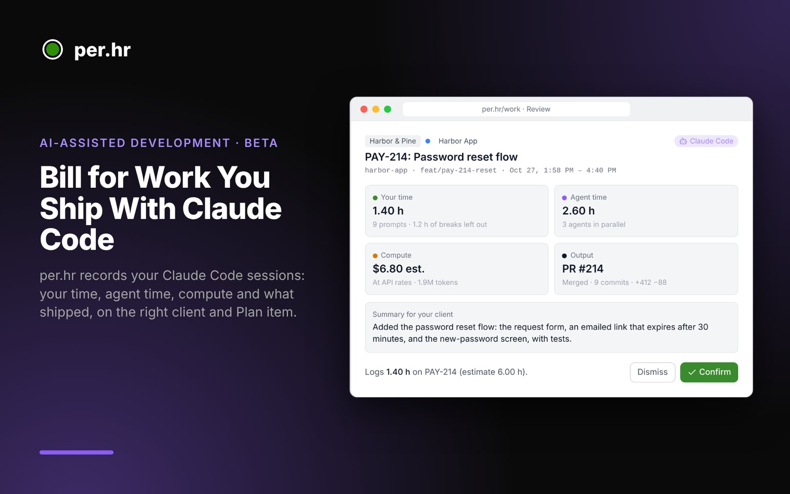

<a href="https://per.hr/features/ai-assisted-development"></a>

# per.hr for Claude Code

Logs your Claude Code sessions in [per.hr](https://per.hr): your time, agent time, compute and what shipped, matched to the client, project and Plan item. Sessions wait in per.hr's Work → AI Sessions until you confirm them, so nothing reaches an invoice without you.

**Beta.** The plugin works with per.hr accounts in the AI-assisted work beta.

## Install

1. In per.hr, open **Configure → Data → Claude Code** and choose **Create a Key**.
2. In a terminal, outside a Claude session:
   ```
   claude plugin marketplace add per-hr/claude-code-plugin
   claude plugin install perhr@perhr --scope user
   ```
   Paste your key when Claude Code asks. At user scope the plugin runs in every repo with one key, and per.hr records only the repos you connect to a project. If some repos record to a different workspace (another team, or Personal), install with `--scope project` from each of those repos instead, each with that workspace's key. Use one scope per repo, never both: two copies send every event twice. `claude plugin list` shows what's installed and enabled.
3. Start Claude Code in the repo once, then connect the repo to a project on the Claude Code card in per.hr.
4. Optional, for cost, tokens and commits: add the settings block from the card to your user settings (`~/.claude/settings.json`, or `%USERPROFILE%\.claude\settings.json` on Windows).

Needs `bash`, `git` and `curl` (on Windows, the Git Bash that Claude Code uses).

## Commands

| Command | What it does |
| --- | --- |
| `/perhr:start PAY-214` | Work on a Plan item, or several: a range `PAY-214:216` or a list `PAY-214+PAY-220`. Switching items later sends the work so far to AI Sessions on its own. |
| `/perhr:status` | Which Plan items this session is recording to (or that it's paused), your time, agent time and cost so far, and how much of the estimate is used. |
| `/perhr:pause` | Stop recording. `/perhr:resume` starts again. |
| `/perhr:done` | Send the session to AI Sessions now, with a one-line summary of what shipped. Then `/perhr:start` the next item in the same Claude Code session. |

A branch named with the reference (for example `feat/pay-214-reset`) attaches the session to that item on its own.

A session without a Plan item is titled from short notes Claude writes as it finishes each piece of work (`perhr note "what changed and in which repo"`), so background work and side projects arrive in AI Sessions with a description. The note is a sentence or two in plain words; you can edit it before confirming.

With several items, your time splits by their estimates; you can change the split in AI Sessions before confirming. The plugin's own commands aren't counted as prompts.

## What's sent

Hook events (session start and end, prompt submitted, turn finished, subagent started and stopped) with the session id, the repo's remote, folder name and branch, the plugin's version, and whether a prompt was one of the plugin's commands (checked on your computer). Notes and `/perhr:done` summaries are sent as Claude wrote them. Prompts, code and file contents stay on your computer. per.hr discards events from repos you haven't connected.

## Guide

The full guide, including how your time is counted and how clients are billed: [per.hr/docs/claude-code](https://per.hr/docs/claude-code).

## License

MIT
