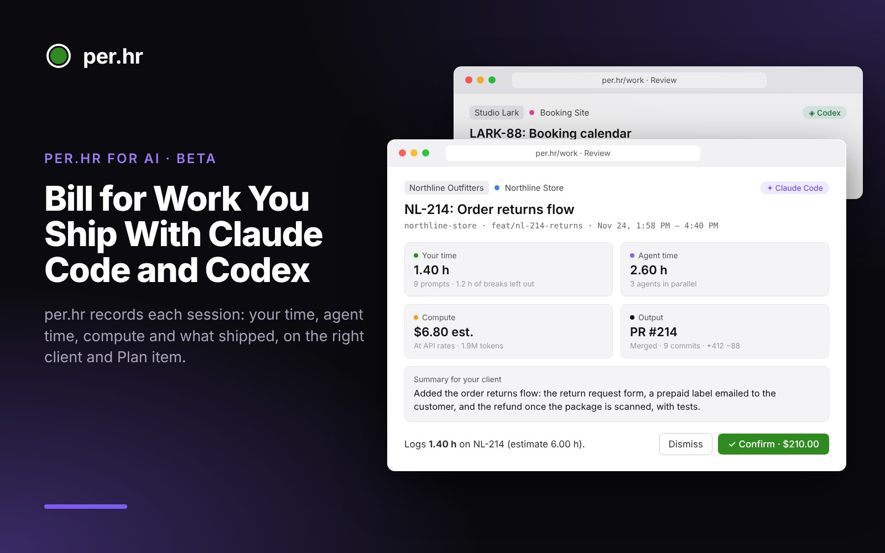

<a href="https://per.hr/features/ai-assisted-development"></a>

# per.hr for Claude Code

Bill clients for your Claude Code work. The plugin logs your Claude Code sessions in [per.hr](https://per.hr): your time, agent time, compute and what shipped, matched to the client, project and Plan item. Sessions wait in per.hr's Review until you confirm them, so nothing reaches an invoice without you.

**Beta.** The plugin works with per.hr accounts in the per.hr for AI beta.

## Install

In any terminal:

```
npx perhr setup
```

Setup signs this computer in (you approve a code at per.hr/device), installs this plugin, and walks through your business, how clients pay you, your first client and project, and linking your code folders. Inside Claude Code, `/perhr:setup` does the same in the chat.

Or install the plugin yourself, outside a Claude session:

```
claude plugin marketplace add per-hr/claude-code-plugin
claude plugin install perhr@perhr --scope user
perhr login
```

At user scope the plugin runs in every repo, and per.hr records only the repos you link to a project. Each repo records to the workspace (Personal or a team) where it's linked. A key made in per.hr before the CLI (Configure → per.hr for AI, or a team's setup link) still works, in `/plugin` → Installed → perhr → Configure or in `~/.perhr/key`; this computer's own key from `perhr login` takes its place.

Needs Node 18.17 or later and `git`.

## Commands

| Command | What it does |
| --- | --- |
| `/perhr:start PAY-214` | Work on a Plan item, or several: a range `PAY-214:216` or a list `PAY-214+PAY-220`. Switching items later sends the work so far to Review on its own. |
| `/perhr:status` | This session's Plan items, your time, agent time and cost so far, and anything waiting. |
| `/perhr:end` | The work is finished: send the session to Review now, with a one-line summary of what shipped. |
| `/perhr:review` | What's in Review, to confirm or dismiss. |
| `/perhr:setup` | Set up per.hr for AI in the chat, one step at a time. |
| `/perhr:pause`, `/perhr:resume` | Pause and resume recording. |

A branch named with the reference (for example `feat/pay-214-reset`) attaches the session to that item on its own.

The plugin includes the `perhr` command (the same as `npx perhr`), so Claude can list and change clients, projects, time, Plan items and invoices for you. Reads run without asking. Every change shows Claude Code's own prompt with the full command, once setup adds per.hr's rules to your settings. Sending invoices and anything involving money is approved on per.hr in your browser. Rates are typed by you at the keyboard, never by Claude.

## What's sent

Hook events (session start and end, prompt submitted, turn finished, subagent started and stopped) with the session id, the repo's remote, folder name and branch, the time, the plugin's version, and whether a prompt was one of the plugin's commands (checked on your computer). Notes and `/perhr:end` summaries are sent as Claude wrote them; Claude writes them about the work itself, never mentioning Claude, AI or the tools used, since clients see them on invoices. Prompts, code and file contents stay on your computer. per.hr discards events from repos you haven't linked, and never connects to your repos on GitHub, Bitbucket or anywhere else.

When per.hr can't be reached, events wait on your computer (`~/.perhr/queue.jsonl`) and go out in order once it's back.

**Record by folder name only:** turn on `folder_only` in `/plugin` → Installed → perhr → Configure, or create the file `~/.perhr/folder-only`. The plugin then sends each repo's folder name in place of its remote address. Link the repos to projects again after turning it on.

**Commits and pull requests:** Claude Code adds a "Co-Authored-By: Claude" line to commits and a "Generated with Claude Code" line to pull requests unless you turn them off. To keep them out, add `"attribution": { "commit": "", "pr": "" }` to your user settings (`~/.claude/settings.json`). per.hr itself never writes to commits, pull requests, issues or tickets.

## Turning it off

`perhr logout` disconnects this computer and keeps everything else. `perhr uninstall` takes per.hr off the computer: it disconnects the key, uninstalls this plugin, removes per.hr's rules, status line and compute from your Claude Code settings (the previous file is saved beside it), and deletes `~/.perhr`. Your per.hr account and everything recorded stay as they are.

## Guide

The full guide, including how your time is counted and how clients are billed: [per.hr/docs/claude-code](https://per.hr/docs/claude-code).

## License

MIT
